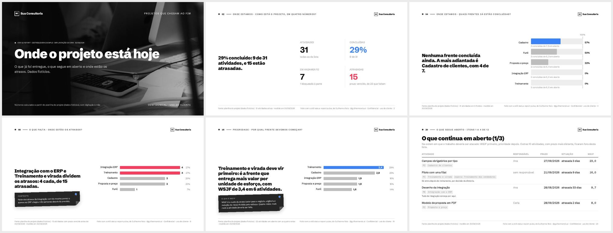

# Status report em slides (status-report-pulse)

Uma skill para o Claude transformar a lista de tarefas de um projeto num status report em PDF,
pronto para mostrar ao dono, ao diretor ou ao cliente. Você manda a lista do jeito que tiver, o
Claude organiza, confere com você o que ficou em dúvida e gera os slides.



O PDF de exemplo, com 23 páginas e dados fictícios, está em [docs/exemplo.pdf](docs/exemplo.pdf).

## O que sai

- Um PDF de slides 16:9, um gráfico por página. Cada slide faz a pergunta que um diretor faria
  ("Onde estão os atrasos?") e responde no título, com o número ("Integração com o ERP e
  Treinamento dividem os atrasos: 4 cada, de 15 atrasadas.").
- O panorama: quanto já foi concluído, se o time dá conta do que chega, o ritmo de entrega, o que
  está atrasado e há quanto tempo, quem está com mais trabalho e o que está envelhecendo.
- A priorização: o que é urgente, por onde começar (WSJF), os quadrantes "fazer agora", "ganho
  rápido" e "aposta estratégica", e a tabela do que segue aberto na ordem de ataque.
- A sua marca na capa e no canto de cada slide, e a cor de quem vai receber dentro dos gráficos.
  Sem logo, sai uma logo provisória com as suas iniciais.
- O HTML que gerou o PDF, com um botão "Salvar em PDF".

Nenhum número é digitado à mão: o script calcula tudo a partir da lista. Serve para implantação
de sistema, obra, projeto de consultoria, carteira de demandas ou qualquer lista com status.

## Como instalar

Você precisa do Claude no computador (claude.ai/download), com o Claude Code, e do Google Chrome.

Peça ao Claude:

```
Instale para mim a skill status-report-pulse com o comando
npx skills add guimreis/status-report-pulse -g -y
```

Se ele disser que falta o Node.js, deixe ele te guiar na instalação. Depois, abra uma conversa nova.

### No Claude.ai (site e aplicativo)

1. Baixe o [status-report-pulse.zip](https://github.com/guimreis/status-report-pulse/raw/main/docs/status-report-pulse.zip).
2. No Claude.ai, abra Configurações, procure a área de Skills (em Capacidades) e envie o zip.
3. Numa conversa nova, mande a sua lista e peça o status report.

Os nomes dos menus podem mudar. Se não achar, procure por "Skills" na ajuda do Claude.

## Como usar

Numa conversa nova, mande a lista (print do quadro, planilha, CSV, export do Jira, Trello,
Planner ou GitHub, ou texto colado) e diga:

```
Monta o status report deste projeto.
```

O Claude vai, numa mensagem só:

1. dizer quantas atividades e frentes entendeu, e a data de referência;
2. mostrar como traduziu cada status e perguntar o que ficou ambíguo;
3. pedir o nome do cliente e do projeto, a sua marca (nome e logo) e as cores de quem recebe;
4. perguntar se você quer a priorização (as notas de valor, urgência, risco e esforço).

Ele gera o PDF, confere as manchetes e te mostra. Você pede os ajustes e ele gera de novo em
segundos.

## O que o relatório não faz

- Não promete data: mostra onde o trabalho está.
- Não julga pessoa: "sem responsável" é um fato da lista.
- Não inventa dado: campo que a lista não traz fica vazio, e o slide que depende dele sai.

## Fotos e fonte

As fotos de capa são do Unsplash (Licença Unsplash, uso comercial livre) e a fonte é a Schibsted
Grotesk (SIL Open Font License). Créditos em
[assets/fotos/CREDITOS.md](skills/status-report-pulse/assets/fotos/CREDITOS.md).

A skill nasceu na Bunker e virou pública, em nome do autor.

## Quem fez

Feito por Guilherme Reis. Ensino empresários e profissionais a trabalhar com IA no dia a dia.

- Instagram: [@guilhermereis.ai](https://www.instagram.com/guilhermereis.ai/)
- Comunidade no WhatsApp, com aula ao vivo toda segunda: [entrar no grupo](https://chat.whatsapp.com/LncD1JNhpog7246d8waj74)

Licença MIT: use, mude e compartilhe à vontade.
